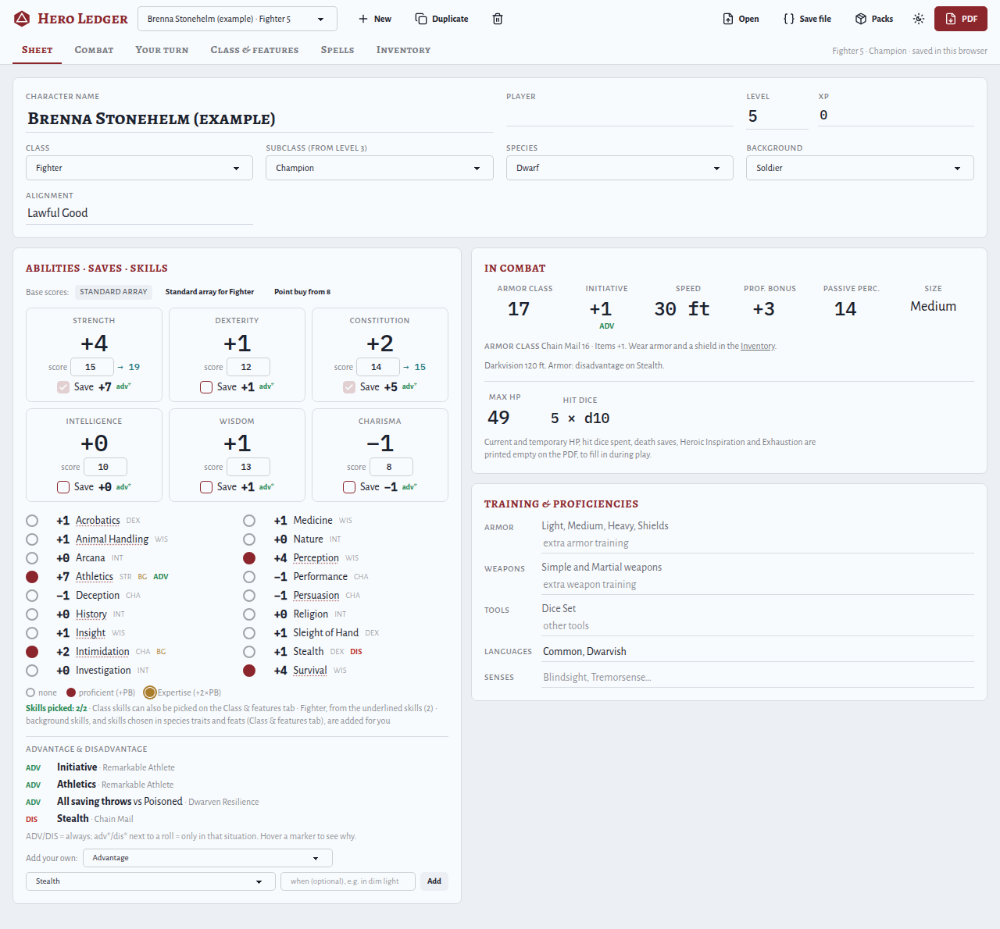
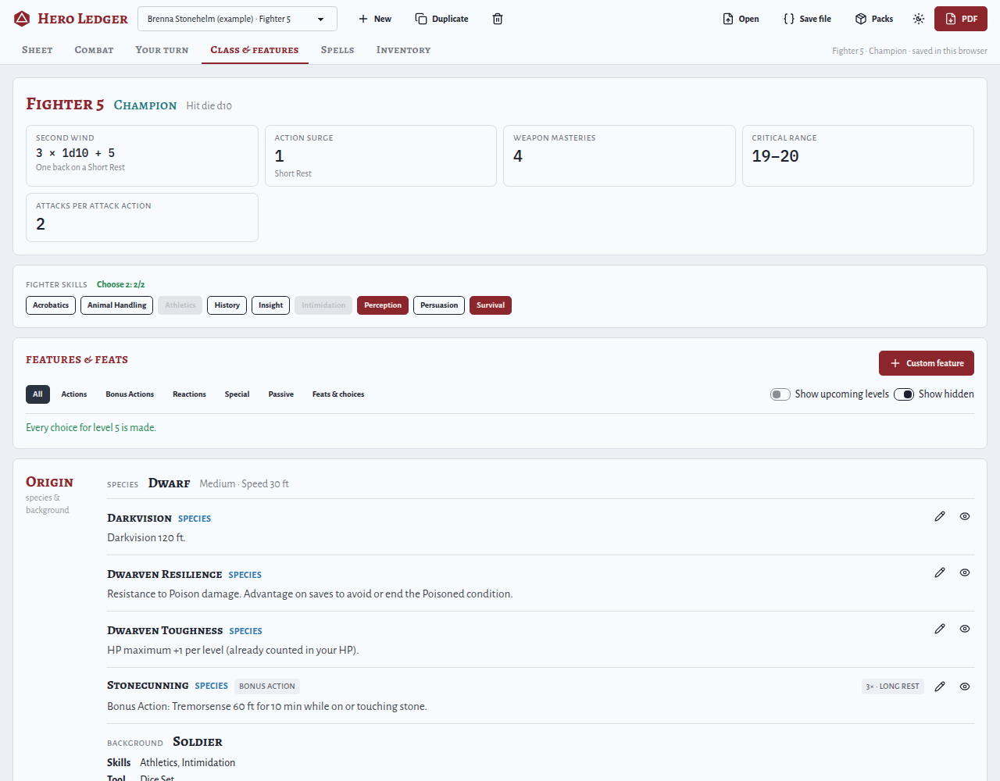
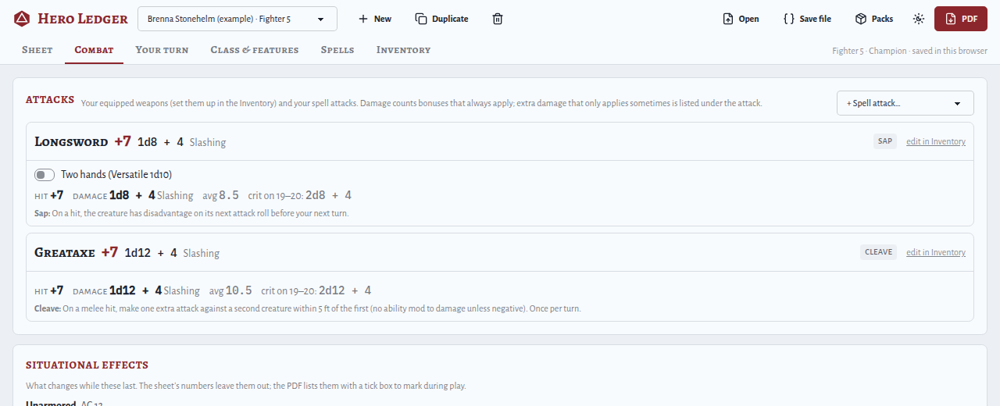
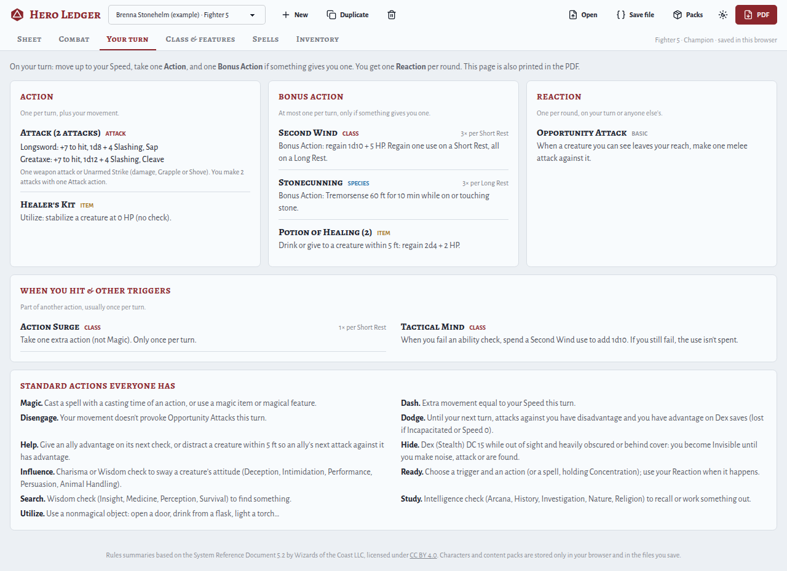
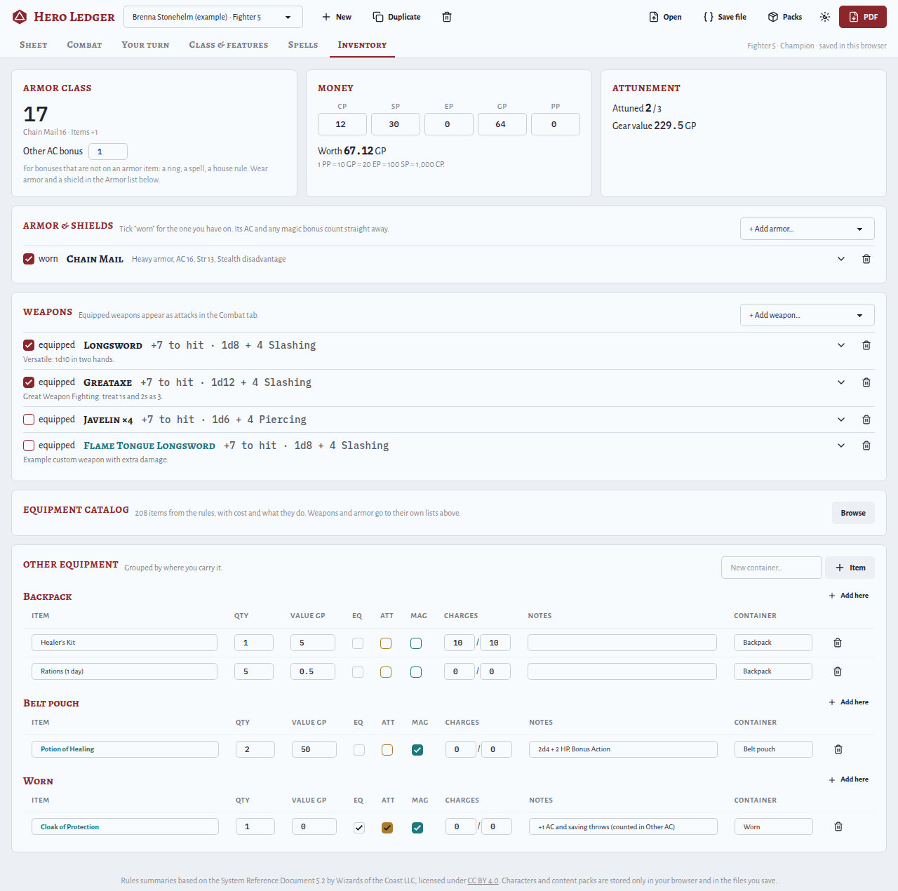
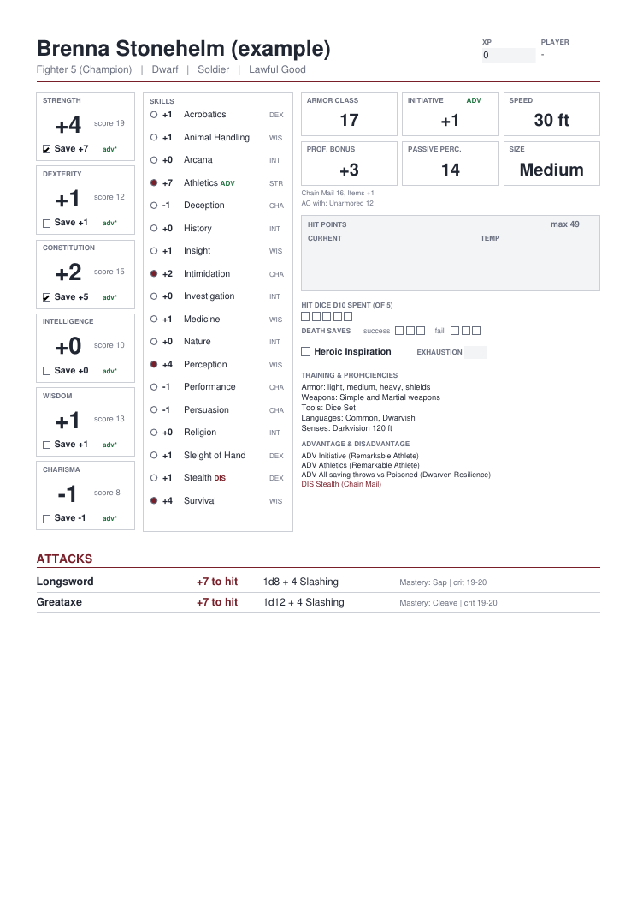
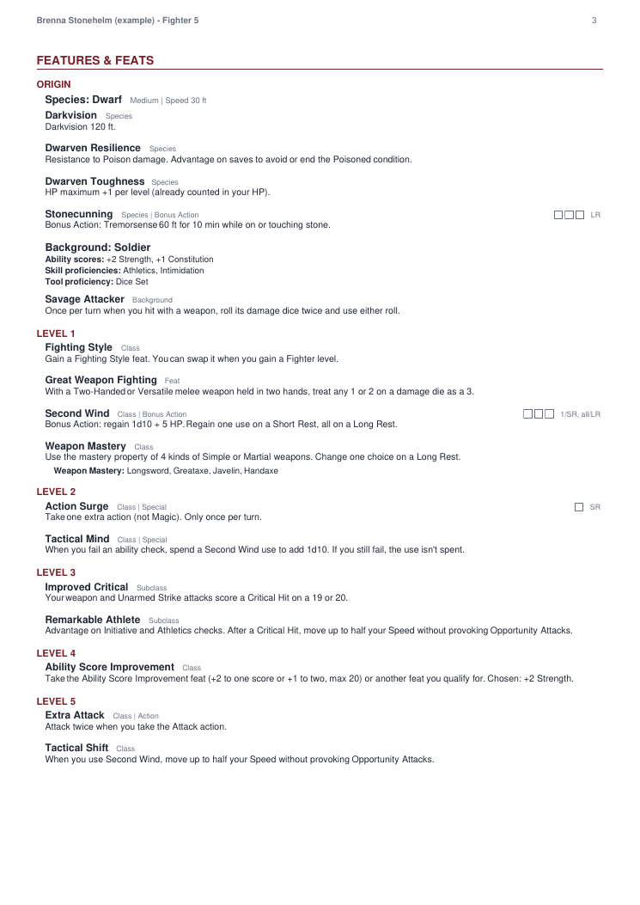

<p align="center">
  
</p>

<p align="center">
  <a href="https://github.com/bolopenguin/hero-ledger/actions/workflows/ci.yml"></a>
  <a href="https://github.com/bolopenguin/hero-ledger/actions/workflows/release.yml"></a>
</p>

**Hero Ledger** is a free character sheet builder for **Dungeons & Dragons 2024** (the "5.5" rules). You pick a class, a species and a background, and it works out everything else: your modifiers, skills, hit points, attacks, armor class, spell slots and what each feature does at your level. When you are happy with your hero, you print a clean, fillable PDF to play with at the table.

**Live app:** <https://bolopenguin.github.io/hero-ledger/> &nbsp;·&nbsp; no account, nothing to install, your characters never leave your browser.

<p align="center">
  
</p>

## Why you might like it

- **It does the arithmetic.** Change a score or gain a level and every number that depends on it updates: skills, saves, attack bonuses, damage, spell save DCs, how many times you can use a feature.
- **It tells you what is left to choose.** Feats, fighting styles, Weapon Mastery, Expertise, cantrips and tools show up in one "still to choose" list, so you never miss a step when building a character.
- **It reminds you of the rules that matter.** Advantage and disadvantage from your features show up next to the right rolls, and the "Your turn" page lists what you can do as an Action, Bonus Action and Reaction.
- **It prints well.** The PDF is made for the table: a sheet, a "Your turn" cheat sheet, your features, spells and equipment, with tick boxes for uses and empty fields for hit points.
- **It is yours.** Every number can be overridden, every feature can be reworded or hidden, and you can add your own weapons, armor, feats, spells or even a whole class.

## How it works

1. **Build your hero.** Pick class, subclass, species and background on the Sheet tab and set your ability scores (standard array, point buy or your own rolls).
2. **Make your choices.** Open **Class & features** and work through the list. The app fills in what your class and species give you automatically and asks only for real decisions.
3. **Print it, or keep it.** Press **PDF** for a fillable sheet. To change the character later, drop that same PDF back into the app with **Open**: the character is stored inside it.

## A quick tour

<table>
  <tr>
    <td width="50%"><br><b>Class &amp; features</b><br>Your class at a glance, the choices still to make, and everything you get level by level.</td>
    <td width="50%"><br><b>Combat</b><br>Attack and damage for each weapon you have equipped, with extra damage listed under it.</td>
  </tr>
  <tr>
    <td width="50%"><br><b>Your turn</b><br>What you can do on your turn, built from your attacks, features, spells and items.</td>
    <td width="50%"><br><b>Inventory</b><br>Wear armor and equip weapons to set your AC and attacks. Make your own custom items too.</td>
  </tr>
</table>

### From the app to paper

<table>
  <tr>
    <td width="50%"><br><b>The sheet</b><br>Abilities, skills, armor, hit points and attacks. Fill in HP and death saves with a pen or in a PDF reader.</td>
    <td width="50%"><br><b>Features and feats</b><br>Everything your character can do, by level, with tick boxes for limited uses.</td>
  </tr>
</table>

## Good to know

- **Rules.** The built-in rules are the free D&D 2024 rules, the System Reference Document 5.2. All twelve classes with their SRD subclasses, the SRD species and backgrounds, feats, weapons, armor and equipment are included. For anything else you can write your own or load a [content pack](docs/content-packs.md).
- **Privacy.** Characters are saved in your browser's storage and in the files you export. There is no server and no tracking. The only outside request is for the page fonts.
- **Backups.** Clearing your browser data deletes saved characters. Keep a PDF (or **Save file**) of anything you care about.
- **Focus.** Hero Ledger is for creating and printing characters. Tracking hit points and spent slots during play is done on the printed sheet.
- **Unofficial.** Hero Ledger is not affiliated with Wizards of the Coast.

## Add your own content

A **content pack** is a small JSON file that adds subclasses, spells, feats, species, backgrounds or option lists, for homebrew, house rules, or material you have the right to use. Load one from **Packs → Load pack file** and it shows up in the dropdowns, with its features filled in by level. Packs travel inside the PDFs you export, so a character opens correctly on another device.

The full format, with examples, is in [docs/content-packs.md](docs/content-packs.md). **Packs → Install example** adds a ready-made homebrew subclass you can copy from.

## For developers

Hero Ledger is a static single-page app. There is no backend: the rules engine, the PDF writer and the storage all run in the browser.

| Part    | What it uses                                                                                                 |
| ------- | ------------------------------------------------------------------------------------------------------------ |
| App     | [SvelteKit](https://svelte.dev) 2 with Svelte 5 (runes), TypeScript, `adapter-static`                        |
| Styling | Tailwind CSS 4 and daisyUI 5                                                                                 |
| PDF     | [pdf-lib](https://pdf-lib.js.org) (standard fonts, real form fields, the character attached inside the file) |
| Tests   | Vitest                                                                                                       |
| Tooling | Yarn 4, Prettier, svelte-check                                                                               |

### Run it

You need Node 22 (see `.nvmrc`) and Corepack, which ships with Node and provides the pinned Yarn version.

```bash
corepack enable
yarn install
yarn dev        # http://localhost:5173
```

| Command        | What it does                                                               |
| -------------- | -------------------------------------------------------------------------- |
| `yarn dev`     | Dev server. Any pack in `content-packs/local/` is installed automatically. |
| `yarn lint`    | Checks formatting with Prettier. `yarn format` fixes it.                   |
| `yarn check`   | Type-checks the app and the Svelte components.                             |
| `yarn test`    | Runs the unit tests: rules maths, equipment, packs and a PDF round trip.   |
| `yarn build`   | Builds the static site into `build/`.                                      |
| `yarn preview` | Serves the built site locally.                                             |

### How the code is organised

```
src/lib/
  data/          the rules as data: classes, species, backgrounds, feats, options,
                 situational effects, weapons, armor and equipment
  calc.ts        the rules engine: ability scores, skills, saves, AC, speed, spellcasting,
                 attacks and the features a character has at a given level
  formula.ts     the small expression language used in descriptions, e.g. {8 + wis + pb}
  advantage.ts   where advantage and disadvantage come from
  turn.ts        the "Your turn" summary, also printed in the PDF
  packs.svelte.ts  content packs: validation, installation and lookups
  store.svelte.ts  the character model, saving in the browser, and migration of old saves
  pdf/           export.ts writes the PDF, import.ts reads a character back from one
  components/    one Svelte component per tab, plus shared pieces
src/routes/      the single page: header, tabs, loading and saving files
scripts/         build-pack.mjs merges pieces of a pack into one file
docs/            documentation and the images used in this README
```

The rules live in `data/` and are applied by pure functions in `calc.ts`, so the same results feed the screen and the PDF, and the tests can check them without a browser. A saved character stores only the player's choices; everything else is calculated each time. Older saves are upgraded when they are loaded.

### Continuous integration, versions and deployment

Two GitHub Actions workflows in `.github/workflows/`, sharing one setup step in `.github/actions/setup/`:

- **CI** (`ci.yml`) runs on every pull request into `main`: formatting, type-check, tests and a build. The build uses the same base path as the live site, so path mistakes show up before merging.
- **Release** (`release.yml`) runs on every push to `main`. It checks and builds the site, then looks at the commit messages since the last version and decides whether there is a new one. If there is, it creates a git tag and a GitHub release with notes (the built site is attached as a zip) and publishes the site to GitHub Pages. If not, the live site stays as it is. You can also start it by hand from the Actions tab to publish the current build.

Versions follow [Semantic Versioning](https://semver.org) and are worked out from [Conventional Commits](https://www.conventionalcommits.org) by [semantic-release](https://semantic-release.gitbook.io) (settings in `.releaserc.json`):

| Commit message                                                     | Effect                                       |
| ------------------------------------------------------------------ | -------------------------------------------- |
| `feat: add a spell picker`                                         | new minor version, for example 0.3.0 → 0.4.0 |
| `fix: wrong AC with a shield`                                      | new patch version, for example 0.3.0 → 0.3.1 |
| `perf: …`                                                          | new patch version                            |
| `feat!: …`, or a `BREAKING CHANGE:` line in the message            | new major version                            |
| `docs:`, `chore:`, `ci:`, `test:`, `refactor:`, `style:`, `build:` | no release, no deploy                        |

A scope is optional: `fix(pdf): wrap long spell names`. The version is the git tag, not the number in `package.json`.

One-time setup for a fork: in **Settings → Pages**, set **Source** to **GitHub Actions**.

The site lives under `/<repository-name>/` on GitHub Pages, so the build runs with the `BASE_PATH` environment variable set. Locally, and on any host that serves the site at the root, it is empty. To host somewhere else, download the zip from a release, or run `yarn build` and publish the `build/` folder. A `netlify.toml` is included for Netlify.

## License

The code is free to use, copy, change and share under the [MIT License](LICENSE).

## Legal

The game rules are not covered by the MIT License. This work includes material from the System Reference Document 5.2 by Wizards of the Coast LLC, available at <https://www.dndbeyond.com/srd>, licensed under the Creative Commons Attribution 4.0 International License (<https://creativecommons.org/licenses/by/4.0/legalcode>). Hero Ledger is unofficial and not affiliated with Wizards of the Coast.
